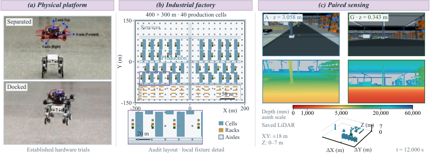
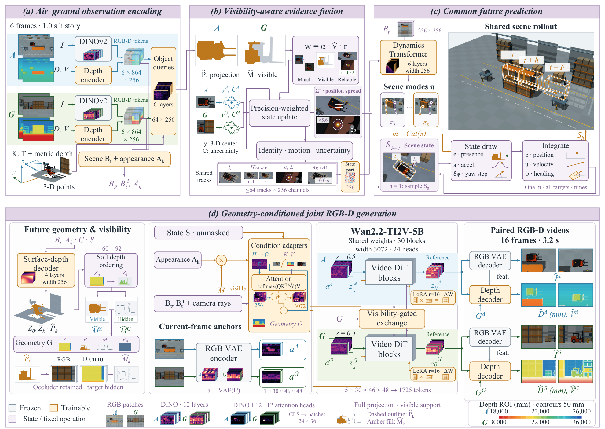

<div align="center">

# AGCR-FACTORY

**Calibrated air–ground sensing · paired future prediction · industrial simulation**


[Overview](#overview) · [Quick start](#quick-start) · [Data](#data-and-units) · [Experiments](#experiments) · [Downloads](#downloads) · [Documentation](#documentation)



</div>

## Overview

A factory environment and research code for studying how aerial and ground observations inform a common future. A target hidden behind a rack in one camera can remain visible in the other. The code separates **evidence about target motion** from **camera-specific visibility**, with controlled paired worlds for measuring the effect of partner evidence.

The repository contains the simulator, collection and annotation pipeline, learning modules, matched ablations, baseline adapters, and evaluation code. Raw datasets, trained research checkpoints, and external foundation-model weights are separate inputs; they are not bundled in this source release.

| Component | What it provides |
| :--- | :--- |
| Factory simulation | Industrial layout, robot dynamics and actuator controllers, moving actors, RGB-D cameras and geometric LiDAR |
| Scripted collection | Visibility groups and transitions, controlled occlusion events, target states, masks and camera calibration |
| Paired supervision | Fixed receiver history with changed partner evidence; fixed world motion with changed camera plans; ambiguous continuations |
| Forecasting and generation | Observation encoding, evidence fusion, shared stochastic state rollout, geometry conditions, RGB-D video adaptation |
| Evaluation | State error, continuation preference, geometric and video metrics, tracking augmentation, and matched controls |

<details>
<summary><strong>Architecture overview</strong></summary>



This diagram shows the implemented module interfaces. It is an architecture illustration; experimental conclusions require the corresponding checkpoint, protocol and evaluation output.

</details>

## Quick start

Clone this repository and download the two packages from its **`V1.0` Release**. The source archive is an alternative to cloning; the assets archive supplies the MJCF, mesh and texture files, compiled model, and editable Blender sources.

If GitHub CLI is installed and signed in, run these commands from the clone:

```bash
gh release download V1.0 --pattern 'agcr_factory_assets*' \
  --pattern 'release_manifest.json' --dir downloads
python3 tools/restore_assets.py --downloads downloads --destination .
```

Use **CPython 3.11 on Linux x86_64** for the supplied simulation runtime:

```bash
python3.11 -m venv .venv-sim
.venv-sim/bin/python -m pip install -e ./air_ground_sim
MUJOCO_GL=egl .venv-sim/bin/python air_ground_sim/run.py demo \
  --profile factory_industrial --seconds 2 --output outputs/factory_demo
```

For CPU headless rendering, use `MUJOCO_GL=osmesa` with the system OSMesa library installed. The full industrial model needs at least **16 GiB of available RAM**; MJCF recompilation requires more. The included MuJoCo runtime has large-model I/O support and should be used with these assets.

```python
from air_ground_sim import Simulator

with Simulator("factory_industrial") as sim:
    observation = sim.observe(width=160, height=120)
    state = sim.step()
```

See the [simulator guide](air_ground_sim/README.md) for robot commands, viewing and geometry export.

## Data and units

The paper pipeline uses synchronized aerial and ground RGB-D histories, camera intrinsics/extrinsics, robot poses, planned camera conditions and annotated target states. The configured forecasting window uses **6 historical frames**, followed by **16 future frames at 5 Hz**; future annotations are supervision and evaluation references.

| Quantity | Convention |
| :--- | :--- |
| RGB | Calibrated camera image; collection specification supports 720 × 480 |
| Depth | Optical-axis depth in **millimetres**, accompanied by validity |
| Positions / LiDAR | Metres in the declared world frame |
| Heading | Radians |
| Joint samples | Eight fixed paired draws per history in the evaluation protocol |
| Splits | Scene/episode and paired-family boundaries, rather than random frame splits |

Depth images in the homepage figure are visualizations of metric measurements; their colors are not depth labels. Follow the [capture contract](air_ground_sim/docs/CAPTURE.md) and [experiment guide](experiments/README.md) when building data indexes.

## Experiments

Use a separate experiment environment. The recorded video-training APIs used **Python 3.12 and CUDA PyTorch**; the simulation bindings use Python 3.11. Install a PyTorch build compatible with your GPU, then install the relevant requirements:

```bash
python3.12 -m venv .venv-exp
.venv-exp/bin/python -m pip install -r requirements-experiments-gpu.txt
# Independent metric dependencies:
.venv-exp/bin/python -m pip install -r requirements-experiments-metrics.txt
```

Configure data and external weights in a copy of [paths.example.json](experiments/paths.example.json). The file uses repository-relative paths. DINOv2 and Wan2.2 code/weights, generated data indexes, statistics and predecessor checkpoints must be supplied before training.

An example two-GPU state-adaptation launch is:

```bash
.venv-exp/bin/python -m torch.distributed.run --standalone \
  --nproc_per_node=2 --module experiments.base48.train \
  --paths experiments/paths.example.json \
  --protocol experiments/base48/protocol.json \
  --phase state --variant paired --seed 17 \
  --output artifacts/runs/paired_state_seed17 \
  --budget-ledger artifacts/budgets/paired_state_seed17.json --gpu-hours 2
```

The example sets a bounded runtime; it does not represent a completed training schedule. Depth and video adaptation consume their predecessor checkpoints. The [experiment guide](experiments/README.md) describes preparation, sampling, paired controls, baseline adapters and evaluation entry points.

## Repository layout

```text
air_ground_sim/                   simulation source, configuration and native runtime
  src/air_ground_sim/             dynamics, control, sensors and exports
  tools/paper_dataset/            scripted collection and geometric annotations
  runtime/                       native engine source, patch, bindings and licenses
  assets/                        restored from the assets package
  authoring/                     restored editable Blender sources
experiments/
  paired_interventions/           controlled paired-world collection and audits
  paper_experiments/agcr_exp/     historical frontend and learning modules
  base48/                        state/depth/video training and paired sampling
  research_extensions/           evidence objectives, matched controls and feedback
  external_baselines/             SynCamMaster and ShareVerse adaptation interfaces
  formal_evaluation/              metric contracts and statistical evaluation
  downstream_tracking/           training-data augmentation and tracking evaluation
docs/assets/                     repository illustrations
tools/                           verified package restoration
```

## Downloads

The `V1.0` Release provides:

- **`agcr_paper_source.tar.gz`** — the browsable repository source and documentation.
- **`agcr_factory_assets.tar.gz`** — current industrial MJCF/MJB, referenced meshes/textures, and five Blender source files. Large archives may be distributed as numbered parts.
- **`release_manifest.json` and `SHA256SUMS`** — file sizes and checksums. The restoration tool validates the full asset archive and every numbered part before extraction.

The asset archive merges into the repository root. It contains no raw training dataset or foundation-model checkpoints.

## Documentation

- [Simulator setup and API](air_ground_sim/README.md)
- [API contracts and modeling assumptions](air_ground_sim/docs/API.md)
- [Collection and annotation protocol](air_ground_sim/docs/CAPTURE.md)
- [Experiment execution and input dependencies](experiments/README.md)
- [Native engine build and validation](air_ground_sim/runtime/BUILD.md)
- [Licenses and upstream components](THIRD_PARTY_NOTICES.md)

## Upstream components and licensing

The project uses [MuJoCo](https://github.com/google-deepmind/mujoco), [DINOv2](https://github.com/facebookresearch/dinov2), and [Wan2.2](https://github.com/Wan-Video/Wan2.2). Baseline interfaces support [SynCamMaster](https://github.com/KlingAIResearch/SynCamMaster) and ShareVerse; their external code and weights remain subject to their upstream terms.

Project-authored software and configuration are released under [Apache License 2.0](LICENSE). Vendored licenses and required upstream copyright notices are preserved. External weights, data, and non-software assets retain their applicable terms; see [THIRD_PARTY_NOTICES.md](THIRD_PARTY_NOTICES.md).
